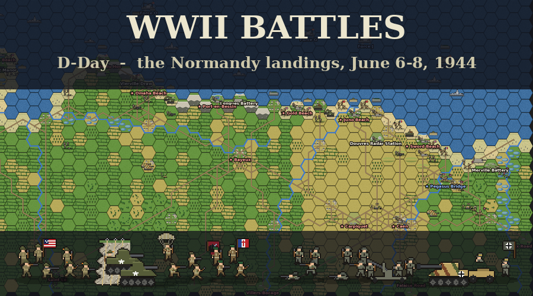
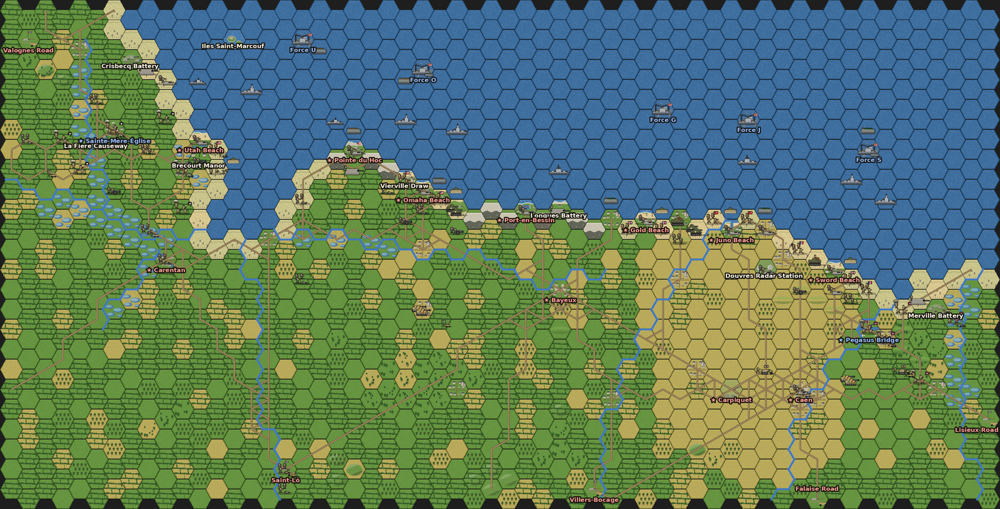

# WWII Battles — an Unciv mod



A Second World War ruleset for [Unciv](https://github.com/yairm210/Unciv), starting with **D-Day: the Normandy landings, June 6–8, 1944**.

* **D-Day scenario** – the invasion from H-Hour to nightfall on June 8. The airborne divisions are already on the ground, the first assault waves have just touched down on Utah, Omaha, Gold, Juno and Sword, and the Rangers are still in their landing craft under Pointe du Hoc. The follow-up waves arrive at their assault forces out at sea, hour by hour, and must sail in and land. The German reserves (the 21st Panzer, the 12th SS Panzer and the Panzer Lehr Divisions, and the infantry from Cherbourg, Brittany and the Seine) come up the roads on their historical timetable: 130 Allied and 88 German units in all. Thirteen **key positions** (the five beaches, Sainte-Mère-Église, Carentan, Pointe du Hoc, Port-en-Bessin, Bayeux, Carpiquet, Caen and Pegasus Bridge) decide the battle. Tested over hundreds of computer-played battles to be a close fight.
* **Normandy map** – a 58 × 25 hex map of the invasion coast (2 km per hex). It runs from the Cotentin west of Sainte-Mère-Église to the Dives, and from the Channel south to Saint-Lô, Villers-Bocage and Caen. It has the five beaches, the cliffs of Pointe du Hoc, the bluffs behind Omaha and the flooded valleys of the Merderet and the Douve. It also has the bocage hedgerows, the open Caen plain, the Iles Saint-Marcouf and the rivers from the Vire to the Orne.
* **48 units** with original pixel art (map sprites, landing craft, full-color portraits and icons) for the Allies, Germany and a neutral base set. The Allies have American, British and Canadian infantry, Rangers, Commandos, paratroopers, Shermans, DD swimming tanks, Fireflies, AVREs, Cromwells, M10s and the battleships, cruisers and destroyers of the bombarding forces. Germany has grenadiers, coastal and Ost battalions, Fallschirmjäger, panzergrenadiers, Panzer IVs, Panthers, StuGs, Nebelwerfers, 88s and the coastal batteries.
* **37 named commanders** with personal abilities (Ridgway, Gavin, Roosevelt Jr., Cota, Gale, Lovat, Keller, Marcks, von der Heydte, von Luck, Kurt Meyer, Rommel…), plus portraits of Eisenhower and Rommel.
* **21 landmarks** with their own art and history: Pointe du Hoc, Les Moulins, Pegasus Bridge, the Merville Battery, the Longues Battery, Bayeux, Caen and more.



---

## Install

You need **Unciv 4.22.9 or newer** (the scenario was built with 4.22.9, and older versions may refuse to load it).

1. In Unciv, open **Mods** → **Download mod from URL**.
2. Paste `https://github.com/ryflan3/WWII-Battles` and press **Download**.
3. Check that the mod appears in the Mods list as exactly **WWII Battles**.

The installed name must be exactly that, because the scenario and the map refer to the ruleset by name. Unciv builds the name from the repository name and the branch, and strips the branch name off again. That works for any branch name without a slash (`/`). If the mod shows up with extra words, such as *WWII Battles claude …*, see *Troubleshooting*.

Instead of the repository link you can also paste the link to a branch (`https://github.com/ryflan3/WWII-Battles/tree/<branch>`) or to its zip file (`https://github.com/ryflan3/WWII-Battles/archive/refs/heads/<branch>.zip`).

Once the repository has the `unciv-mod` topic (see *Final steps* below), it also appears in Unciv's built-in mod list.

## Play D-Day

1. **New Game** → **Map Type: Scenario**, then choose a D-Day scenario. The scenario sets everything else: the base ruleset changes to **WWII Battles**, and the player list shows the **Allies** (Human) and **Germany** (AI). Each scenario is the same battle at a different difficulty. Difficulty sets how strong the AI-controlled army fights:

   | Scenario | Difficulty | AI army strength |
   |---|---|---|
   | D-Day (Easiest - Recruit) | Recruit | −15% |
   | D-Day (Easier - Regular) | Regular | −5% |
   | **D-Day** | Veteran | normal |
   | D-Day (Harder - Elite) | Elite | +10% |
   | D-Day (Hardest - Bloody Omaha) | Bloody Omaha | +20% |

2. **Choose your side.** By default you command the Allies. To play Germany, click **Human** next to the Allies to make it **AI**, then click **AI** next to Germany to make it **Human**. Set both to Human for a two-player hotseat game.
3. **Start game!**

A scenario is a battle that is already set up, so Unciv locks the other New Game options while one is selected: the base ruleset, the map, which nations take part, the difficulty and the game options. This is normal. Only the Human/AI buttons stay open. The locked options panel still shows your last game's settings, not the scenario's. What the scenario actually uses:

* **At war from the first turn.** The war cannot end in peace.
* **The terrain is revealed and units are hidden.** Both commanders have maps, so you see the whole coast, but enemy troops only appear where your own units can see them.
* **No barbarians.**
* **Cities cannot be razed.** A captured city stays on the map and can be taken back.
* **No new units.** Cities cannot raise any: the armies are the historical ones.
* **No happiness or golden ages.** Holding and capturing towns causes no unhappiness.

**Scale.** One hex is 2 km (about 1¼ miles). June 6 is played hour by hour; June 7 and 8 in two-hour turns; each night is compressed into two turns, and at night every unit sees one tile less.

| Turn | Time |
|---|---|
| 0 – 16 | June 6 (D-Day), 6 AM – 10 PM, one hour per turn |
| 17 – 18 | Night of June 6–7 |
| 19 – 27 | June 7, 5 AM – 9 PM, two hours per turn |
| 28 – 29 | Night of June 7–8 |
| 30 – 38 | June 8, 5 AM – 9 PM, two hours per turn |

**The clock.** In the scenario, the top bar shows the date and time next to the turn number: the calendar is the day of June, and the watch is the hour on the 24-hour clock (13 is 1 PM). Click the turn number to see the victory status.

**Briefings and history.** Your first turn opens with a briefing on the situation and your orders: how to win, which key positions you hold, where your headquarters is, and when your reinforcements arrive. Then, at the great moments of the battle, a message tells what happened at that hour in 1944: the Rangers at Pointe du Hoc, Bloody Omaha, the destroyers closing the shore, Lovat's commandos reaching Pegasus Bridge, the 21st Panzer's drive to the sea at Lion, the 12th SS at Authie and Buron and more, 19 in all. Every message has a button to turn the history messages off. A reminder before the last turn always shows.

**The landings.**

* The five **assault forces** (Force U, O, G, J and S) are cities at sea, out of the German army's reach. The Allied headquarters is Force G, off Gold Beach, in the middle of the five.
* The **follow-up waves** appear in their landing craft beside their assault force and must sail in. Landing craft move 5 tiles. Landing on a beach takes the rest of the turn, except for Rangers, Commandos and DD tanks, which land for one movement point and attack from the sea at full strength. Once a **beach** is in Allied hands, the waves for it come ashore there instead.
* At sea, troops in landing craft are vulnerable. Get them ashore quickly.
* **Once ashore, troops cannot re-embark.** German units cannot enter the sea.
* The **warships** (battleships, cruisers and destroyers) can bombard anything within 2–3 hexes of the sea. The German **coastal batteries** (Crisbecq, Pointe du Hoc, Longues, Merville) fire only at ships and landing craft.

**On the field at the start (6 AM, June 6).** The Allies have 60 units: the 82nd and 101st Airborne around Sainte-Mère-Église, the 6th Airborne east of the Orne, the first waves on the five beaches, the DD tanks swimming in, and the next waves (the 5th Rangers, the 22nd Infantry and Lord Lovat's commandos) in their landing craft beside their fleets. Germany has 44 units: the coastal divisions in their strongpoints, the 91st Air Landing Division and the 6th Fallschirmjäger Regiment in the Cotentin, the 21st Panzer Division around Caen and the corps reserve at Saint-Lô.

**Reinforcements** appear at the start of their turn in or next to their entry city. The Allies arrive at the five assault forces, plus glider landings at Sainte-Mère-Église and Pegasus Bridge. Germany arrives at Saint-Lô (its headquarters), the Valognes Road, Villers-Bocage, the Falaise Road and the Lisieux Road. The full order of battle is in [docs/ORDER_OF_BATTLE.md](docs/ORDER_OF_BATTLE.md), and in-game in the Civilopedia under each "Arrivals" building. If the enemy captures an airhead or a road town, the reinforcements still due there are lost.

**Victory**

* **Hold the Beachhead** (Allies) – hold at least **10 of the 13 key positions** at the end of turn 38 (9 PM, June 8). That is as many as the Allies actually held: everything but Carentan, Carpiquet and Caen.
* **Contain the Invasion** (Germany) – hold at least 4 key positions at the end of turn 38, doing better than the Germans did in 1944.
* **Breakout** (Allies) – capture the German headquarters at Saint-Lô at any time. It is far stronger than any other city (strength 40, 300 extra hit points).
* **Into the Sea** (Germany) – hold all five beaches at the end of any turn from turn 10 (4 PM, June 6) onward: Rommel's plan to defeat the invasion on the beaches.

**Tactics of 1944**

* The bocage hedgerows are a defender's paradise: +33% defense, they block line of sight and tanks fight at −20% in rough terrain. Use infantry there and keep the armor for the open Caen plain.
* Naval gunfire is the Allies' heavy artillery. Fight within reach of the ships while you can.
* Allied fighter-bombers rule the daylight sky: Allied attacks in the open get +10% by day.
* Generals inspire troops within 2 hexes, but a general caught alone by the enemy is killed.
* German infantry carry Panzerfausts (+25% vs armor), and the 88s are deadly against tanks (+100%).

## Other ways to play

* **Custom map:** New Game → base ruleset **WWII Battles** → **Map Type: Custom** → map **Normandy (free play)**. Pick your nation and the AI's nation in the player list as in any Unciv game. Each side starts with a Supply Column (founds a headquarters) and a small army, and builds the rest. The historical armies, key positions and arrival timetable are only in the scenario. Unciv's AI rarely starts a war on a map this small, so **declare war yourself on turn 1**: open **Diplomacy** (top left), select the enemy and choose *Declare war*.
* **Random maps:** pick **WWII Battles** as the base ruleset on any generated map.
* **Map editor:** the Normandy map can be opened and edited in Unciv's map editor.

## Troubleshooting

**The game starts with a Supply Column, a handful of units, no cities and a dark map.**

That is free play, not the battle: the game was started with **Map Type: Custom** (map *Normandy (free play)*) or **Generated**. Its opening message says so. For the battle, start a New Game and set **Map Type: Scenario**, then pick **D-Day**. The player list must show **Allies** and **Germany** with Human/AI buttons. The battle opens with both armies on the field, the fleets and towns already in place, the whole map revealed and the armies at war.

**Picking a D-Day scenario resets the Base Ruleset to a Civ V ruleset, the players turn into "Random", nothing can be changed, and Start says "It looks like we can't make a map with the parameters you requested!"**

Your copy of the mod is installed under the wrong name, so Unciv can't find the *WWII Battles* ruleset that the scenario needs. The custom map still works with a wrongly named copy, which makes this easy to miss.

**Check:** on the New Game screen, open the **Base Ruleset** list. It must contain exactly `WWII Battles`. A longer name, such as `WWII Battles claude unciv …`, is a broken copy. It comes from a download of a branch whose name contains a slash (`/`): Unciv cannot strip such a name off cleanly.

**Fix:**

1. In Unciv, open **Mods** and **delete every copy** of the mod.
2. Install it again in either of these ways:
   * from the **Downloadable mods** list in the Mods screen, or
   * with **Download mod from URL** and exactly `https://github.com/ryflan3/WWII-Battles`.
3. Check that the Mods list shows exactly **WWII Battles**.

On desktop you can instead rename the folder inside Unciv's `mods` folder to exactly `WWII Battles`.

## The rules in brief

**Armies**

* **Allies – Operation Overlord:** land units can embark, and landing craft move 5 tiles. +10% Strength when attacking in open terrain by day (fighter-bombers). +5 HP healing for land units (ample medical and supply services).
* **Germany – Atlantic Wall:** +10% Strength (veteran officers and NCOs, quick counterattacks, superb weapons). +25% Strength when defending in rough terrain (the bocage). +5 HP healing in friendly territory.

**Unit types**

| Type | Role |
|---|---|
| Infantry | Regiments, brigades, Rangers and Commandos. Can dig Foxholes (+40% defense) in 2 turns. |
| Airborne | Paratroopers and glider troops: tough defenders that ignore zones of control. In free play they can paradrop up to 5 hexes from friendly territory; in the scenario they have already dropped. |
| Armor | Tanks and assault guns: can move after attacking, −20% in rough terrain. Shermans are good against infantry; Fireflies, Panthers and StuGs against armor. |
| Anti-Tank | 88s and anti-tank guns: +100% vs armor, −25% when attacking. |
| Artillery | Field artillery (range 2) and Nebelwerfers. German guns must set up before firing. |
| Warship | Battleships and cruisers (range 3), destroyers (range 2). The headquarters ships cannot move or fight. |
| Fortification | Coastal batteries: cannot move, fire only at ships and landing craft. |
| Commander | Generals: an aura of +15% within 2 hexes, plus a personal ability. |
| Support | Medics (heal adjacent units), Supply Column (founds a headquarters in free play). |

Full stats are in [docs/UNITS.md](docs/UNITS.md).

**Terrain**

| Terrain | Move | Defense | Notes |
|---|---|---|---|
| Grassland / Plains | 1 | – | open ground: the Caen plain is mostly plains |
| Ridge | 1 | +15% | elevation 1: see and shoot over lower ground |
| Hill | 2 | +25% | elevation 1, rough |
| Forest | 2 | +25% | rough, blocks line of sight |
| Bocage | 2 | +33% | the hedgerow country: rough, blocks line of sight |
| Orchard | 1 | +10% | |
| Town | 2 | +30% | rough, blocks line of sight |
| Beach | 1 | −10% | no cover |
| Bluffs | 2 | +25% | the slopes behind Omaha: elevation 1, rough |
| Cliffs | 3 | +50% | Pointe du Hoc and the Calvados cliffs: elevation 1, rough |
| Flooded | 3 | −15% | the fields Rommel flooded behind Utah and in the Merderet and Douve valleys |
| Rivers | – | – | crossing uses all movement, attacking across is −20%; roads have bridges |
| Roads | ⅓ | – | columns move three times as fast |

The landmarks are special tiles with their own art, defense and elevation, and each has a Civilopedia entry with its history.

---

## Final steps for you

1. **Optional: rename the default branch to `main`.** It is not needed: Unciv's own download code was run on this repository with the current default branch (`ccr-48c75dff-vcd35d`), and the mod installed as **WWII Battles**. `main` is just tidier. If you do rename it, don't choose a name with a slash (`/`) in it, such as `claude/…`: Unciv cannot strip such a name off and installs the mod under the wrong name (see *Troubleshooting*). To rename: on GitHub, open the repository → **Settings** → **General** → **Default branch**, click the pencil icon (*Rename branch*), type `main` and confirm.
2. **Add GitHub topics** so Unciv's mod browser lists the mod: on the repository page, click the gear next to *About* and add `unciv-mod`, `unciv-mod-rulesets` and `unciv-mod-maps`.
3. **Install and test in Unciv** (see *Install* above), then play a few turns of the scenario as each side.
4. **Optional:** add a `LICENSE` file if you want others to reuse the mod (MIT or CC-BY are common for Unciv mods).

## Editing the mod

Most JSON files and **all images** are generated by the scripts in `tools/`. Edit the scripts, not the generated files, then rebuild.

| You want to change… | Edit |
|---|---|
| Unit stats and abilities | `tools/gen_units.py` |
| Promotions and commanders' abilities | `tools/gen_promotions.py` |
| The arrival buildings and unit names | `tools/gen_buildings.py` |
| The briefings, the history messages, the clock and the victories | `tools/gen_events.py` |
| The terrain and the landmarks | `tools/gen_terrains.py` |
| The order of battle, key positions, opening deployment, arrival times, entry points and the victory target | `tools/dday_oob.py` |
| The map's geography | `tools/normandy_geo.py` |
| Graphics | `tools/art/*.py` |
| Nations, eras, difficulties, global rules | the hand-written files in `jsons/` (`Nations.json`, `Eras.json`, `Difficulties.json`, `GlobalUniques.json`, `ModOptions.json`, `UnitTypes.json`, `TileImprovements.json`, …) |

Then run:

```bash
tools/build_all.sh              # regenerate everything and run Unciv's validator
tools/build_all.sh --simulate   # ...and let the AI play the whole battle as a smoke test
```

This needs Python 3 with Pillow, Java 21 and internet access. The first run downloads the official `Unciv.jar` (4.22.9) and Gradle. The build uses the real Unciv engine to pack the texture atlas (`game.atlas`/`game.png`), write the free-play map in `maps/` and the scenario saves in `scenarios/`, and run Unciv's own ruleset validator. It also renders `docs/normandy_map.png` and `preview.png` with the mod's own art, and writes the docs in `docs/`.

To check the balance after a change, let the computer fight the battle several times. Build the tool first with `./gradlew installDist` in `tools/cwtool`. Then, from `tools/cwtool/work` (created by the build), run `../build/install/cwtool/bin/cwtool balance "<repo>/scenarios/D-Day" AI <seed>` once per seed. Each run prints one `RESULT` line: the winner, how and when, the key positions held by each side at turns 2, 4, 8, 12, 16, 19, 23, 27, 32 and 38, when each beach fell, and the losses. Use `Allies` or `Germany` instead of `AI` to have that side played by Unciv's automation as the human seat. Two environment variables help to find out *why* a battle went the way it did:

* `LOSSES=1` adds a line with who destroyed the German units, by type.
* `WATCH="<city name>"` prints the fight around that city every turn: its owner, its health and every unit within 3 hexes.

You can also simply start the desktop version of Unciv with this folder in its `mods` directory: it re-packs the atlas itself whenever images change.

### Repository layout

```
jsons/          ruleset (Units, UnitTypes, UnitPromotions, Nations, Terrains, Buildings, Events, VictoryTypes, ...)
jsons/TileSets/ how the HexaRealm and FantasyHex tilesets layer the new terrain
Images/         source images (unit sprites, landing craft, portraits, icons, terrain overlays, leaders, emblems)
game.atlas, game.png, Atlases.json   packed textures the game loads
maps/Normandy (free play)             the map for free play (also usable in the map editor)
scenarios/                            the D-Day scenario, one save per difficulty
docs/           order of battle, unit reference, map picture
tools/          generators and the Unciv-engine build tool (tools/cwtool)
```

## How it was checked

* Unciv 4.22.9's own ruleset validator (the in-game "Locate mod errors" check) reports **no problems**.
* The map and the five scenario saves were written and read back by the real Unciv 4.22.9 engine (`tools/cwtool`).
* Unciv's own *Download mod from URL* code was run on this repository on GitHub with the repository link, the branch link and the branch's zip link. Each one installed the mod as **WWII Battles**, and the scenario started from the downloaded copy.
* The scenario was loaded the same way Unciv's New Game screen loads it, and the computer played the whole battle from each seat. The armies started at war, with the terrain revealed, enemy units hidden and no barbarians. The briefing and the history messages appeared on their turns, every arrival appeared on its turn with its historical name, and no city was razed.
* That test found a trap in how Unciv starts a scenario: the New Game screen runs the first player's turn start once with the turn counter at 1, then sets it back to 0. Anything due on turn 1 would arrive twice. So the units due at 7 AM (the 5th Rangers, the 22nd Infantry, Lord Lovat and his commandos, and the 352nd Fusiliers) start on the map instead, at their entry points.
* **No crashes.** An early version let the DD tanks swim without embarking. In about 1 battle in 60 that tripped an error inside Unciv's own AI pathfinding and crashed the game. The DD tanks now come in like the other waves, as landing craft with their own swimming-tank picture, and over 250 test battles since then none crashed.
* **Balance.** The computer played the battle against itself over and over (`cwtool balance`: each game gets fresh random ids and unit order, so each one plays out differently). With the final setup, out of 48 AI-vs-AI battles on the default difficulty the Allies won 30 and Germany 18, all by Hold the Beachhead or Contain the Invasion. On average the Allies held 7.5 key positions at nightfall on D-Day and 10 by nightfall on June 7, and ended with 10.8. Utah, Gold and Juno always fall in the first hours; Omaha usually holds out until June 7, and Sword falls in two games out of three.
* Who ends up holding what (48 AI-vs-AI battles): Utah, Gold and Juno always end Allied, and Sainte-Mère-Église, Port-en-Bessin, Omaha and Pointe du Hoc in 85–96% of battles. Pegasus Bridge, Bayeux, Carentan and Sword are Allied in 69–77%, and Caen and Carpiquet, the German anchors of 1944, in 56–63%.
* The tests also chose the setup. Unciv's AI aims its attacks at the enemy city nearest its own capital. With the Allied headquarters off Omaha, it sent most of its army west, and Sword Beach often went unattacked all battle. With the headquarters at Force G, in the middle of the five beaches, it fights along the whole front. Germany then needed its +10% to make a fight of it: in an earlier version without it, the Allies won 22 battles in 24.
* **Difficulty.** In battles where Unciv's automation played the human side (choosing its own promotions) against the AI, the automated Allies won 6 of 12 on the default difficulty (Veteran), 8 of 8 on Easiest and 1 of 8 on Hardest. The automated Germans won 5 of 12 on Veteran, 8 of 8 on Easiest and 0 of 8 on Hardest. A human usually beats the automation, so try Harder if Veteran feels easy.

## Notes

* All graphics were drawn from scratch by the scripts in `tools/art`; no images were copied from Unciv or elsewhere. The German side is shown with the Balkenkreuz, the cross on its tanks and aircraft; the mod shows no swastikas.
* The history texts name the men who led the battle. Kurt Meyer and Sepp Dietrich are among them because they commanded the 12th SS Panzer Division and its corps in Normandy; their entries also record the war crimes for which they were convicted.
* The leader lines for Eisenhower and Rommel are written for the game, except where a text says it quotes them.
